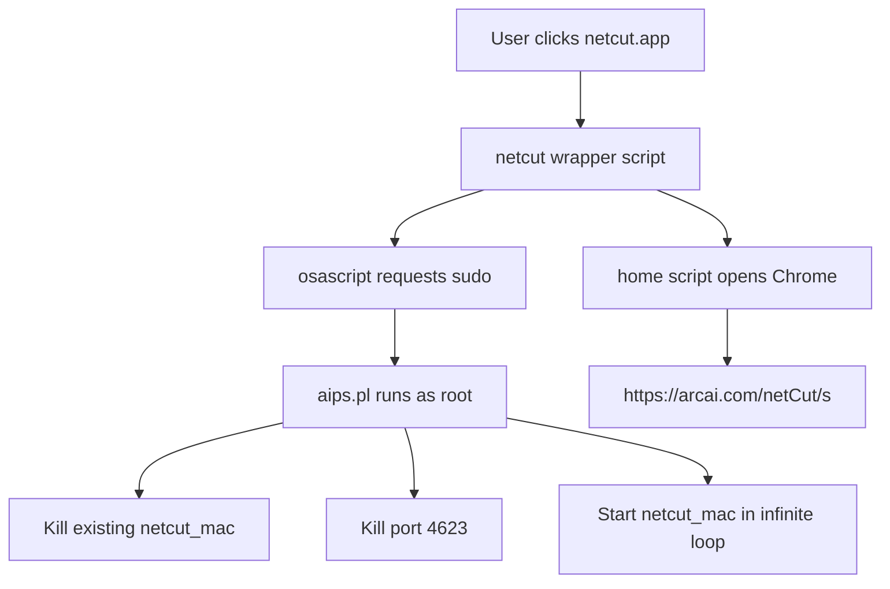

# Netcut (arcai.com) - Complete Reverse Engineering Analysis for macOS

## Application Overview

| Property | Value |
|----------|-------|
| **Application** | Netcut v3.0.115 (Build 1) |
| **Developer** | arcai.com |
| **Bundle ID** | `com.arcai.Netcut` |
| **Location** | `/Applications/netcut.app` |
| **Architecture** | Mach-O 64-bit x86_64 |
| **Wrapper** | Platypus-5.3 (script-to-app converter) |
| **Minimum macOS** | 10.8.0 |

---

## Application Structure

```
/Applications/netcut.app/
├── Contents/
│   ├── Info.plist
│   ├── MacOS/
│   │   └── Netcut (symlink to Resources/netcut)
│   └── Resources/
│       ├── netcut              # Bash wrapper (1.4 KB)
│       ├── aips.pl             # Perl process manager (13 KB)
│       ├── home                # Chrome launcher (147 bytes)
│       ├── netcut_mac          # MAIN ENGINE - Mach-O binary (14.7 MB)
│       ├── macdata             # MAC vendor/OUI database (737 KB)
│       ├── record              # Captured device records (24 KB)
│       ├── script              # Duplicate of netcut wrapper
│       ├── AppSettings.plist   # Platypus settings
│       ├── AppIcon.icns
│       ├── favicon.ico
│       └── [runtime files...]
```

---

## Launch Flow



---

## Core Binary: `netcut_mac` (14.7 MB)

### Technology Stack
- **Language**: C++17 (STL, smart pointers)
- **Crypto**: OpenSSL 3.x (statically linked)
- **Async I/O**: Asio (standalone)
- **WebSocket**: WebSocket++ 0.8.2
- **HTTP Client**: libcurl
- **Packet Crafting**: Tins library
- **Packet Capture**: libpcap/BPF
- **JSON**: Likely nlohmann/json

### Dynamic Libraries
```
/usr/local/opt/curl/lib/libcurl.4.dylib
/usr/lib/libz.1.dylib
/System/Library/Frameworks/Security.framework
/System/Library/Frameworks/IOKit.framework
/System/Library/Frameworks/CoreFoundation.framework
/usr/lib/libc++.1.dylib
/usr/lib/libSystem.B.dylib
```

---

## Complete Class Hierarchy & Functionality

### 1. ARP Spoofing / MITM Engine (`CNetCutSpoofer`)

| Method | Description |
|--------|-------------|
| `_ChangeArpTable()` | **Core ARP poisoning** - modifies target ARP cache |
| `SetAttack()` | Enables attack mode |
| `MakeSureOffOn()` / `MakeSureOffOn6()` | IPv4/IPv6 - ensures target stays cut off |
| `TimerMakeSureOnAll()` | Periodic re-ARP to maintain spoof |
| `TimerMakeSureoffAll()` / `TimerMakeSureoffAll6()` | Periodic cut-off enforcement |
| `OnArpPacket()` | Processes incoming ARP packets |
| `OnDHCPPacket()` | Intercepts/handles DHCP |
| `OnICMP6()` | Handles IPv6 Neighbor Discovery |
| `SayIAmNetCut()` | Broadcasts presence (anti-collision?) |
| `DetectNetcutDefender()` | Detects competing Netcut instances |
| `DefenderProcess()` | Neutralizes other Netcut defenders |
| `GetIsBeenAttack()` | Returns true if under ARP attack |
| `SetDefender(bool)` | **Defender mode** - protects local ARP table |
| `LoadOption()` / `SaveOption()` | Persists spoofing configuration |

---

### 2. Network Scanning & Discovery (`CAdapterMonitor`, `CAdapterMonitorBase`)

| Method | Description |
|--------|-------------|
| `LoadAdapter()` / `_LoadAdapterList()` | Enumerates all network interfaces |
| `_LoopDevs()` / `LoopDevs()` | Active scanning on each adapter |
| `_UseAdapter(int)` | Selects primary interface |
| `PubAdapter()` | Publishes device info via IPC |
| `GetAdapterList()` | Returns interface list |
| `StartLoad()` | Initiates discovery |
| `_cleanUp()` / `_LoadDevs()` | Internal lifecycle |

**Scanning Techniques**:
- ARP requests (IPv4)
- Neighbor Solicitation (IPv6)
- NBTS/NetBIOS (nbtscan 1.0.35 embedded)
- DHCP monitoring
- Passive packet observation

---

### 3. Bandwidth Control / Speed Limiting (`CNetCutSpeedLimiter`)

| Method | Description |
|--------|-------------|
| `SetComputerSpeed(MAC, int)` | **Set speed limit in KB/s** |
| `SetComputerSpeedDelay(MAC, int)` | **Add latency in milliseconds** |
| `APISetComputerSpeed()` / `APISetComputerLag()` | REST API handlers |
| `SetAllComputerSpeed(int)` | Global bandwidth cap |
| `_SetComputerForward(MAC, bool)` | Enable/disable packet forwarding |
| `_SetComputerMTU(MAC, int)` | MTU manipulation (fragmentation) |
| `_SetComputerBlockActivity(MAC, int)` | Block specific activities |
| `_SetComputerSkipUnit(MAC)` | Bypass limiting for MAC |
| `LoadBlackList()` / `SaveBlackList()` | Persistent blocklists |
| `_CheckBlackList()` | Enforces blacklist on packets |
| `_OnLoadGroundedSetting()` | Loads "grounded" (blocked) devices |
| `_OnLoadLagSetting()` | Loads per-device lag config |
| `_OnLoadMTUSetting()` | Loads MTU restrictions |
| `_GroundRoutingTimer(MAC)` | Timer for routing rules |
| `_OnOFFCheckTimer(MAC)` | Periodic enforcement check |
| `SetTrailStart()` | Trial mode enforcement |

---

### 4. Traffic Analysis & Monitoring (`CNetCutTraffic`)

| Method | Description |
|--------|-------------|
| `_processTraffic(packet)` | Main packet processing pipeline |
| `_processSpeed(packet)` | Bandwidth calculation per device |
| `_RecordPacket(packet)` | Stores packet metadata |
| `_OnRecordMacTraffic(MAC, packet)` | Per-MAC traffic accounting |
| `_PublishTraffic()` / `_PublishTraffiReport()` | Real-time stats broadcast |
| `OnServiceActivityIP()` / `OnServiceActivityIP6()` | IP activity tracking |
| `_OnNewDomainIP(rule)` / `_OnNewDomainIP6(rule)` | Domain resolution logging |
| `_IsMatch(rule)` / `_IsMatchDNS(traffic)` | Rule engine for filtering |
| `addRule(rule)` | Adds traffic filtering rules |
| `OnClientRule4()` / `OnClientEditRule4()` | Client rule management |
| `_TimerCheckMacSpeed()` | Periodic speed limit verification |
| `_LoadDomainName()` | Loads domain blocklist |
| `_RequestDomainIP()` | DNS resolution for rules |
| `_QueryIP()` | IP lookup for domain rules |

---

### 5. Packet Routing & Injection (`CNetCutRouter`, `CNetCutPacketSender2`)

#### CNetCutRouter
| Method | Description |
|--------|-------------|
| `_EnableRouter()` | Enables kernel packet forwarding |
| `_DisableForward(interface)` | Disables forwarding |
| `_RuleAction(MAC, in_pkt, out_pkt)` | Core packet manipulation |
| `_BlockDNS443()` / `_Block6DNS443()` | Blocks DNS over HTTPS (443) |
| `_BlockMTU(MAC)` | MTU-based fragmentation attack |
| `OnIPRedirectControl()` | IPv4 redirect handling |
| `OnIPRedirectControl6()` | IPv6 redirect handling |
| `OnManualAction(packet)` | Manual packet injection |
| `WaitForward(speedlimit, uint)` | Rate-limited forwarding |
| `_GetPacketDirection()` | Determines packet flow direction |
| `_MarkTrafficSpeed(packet)` | Tags packet with speed info |
| `_NULLPayLoadPacket()` / `_NULLPayLoadPacket2()` | Null payload injection |
| `_OnGateInbound()` / `_OnGateInbound2User()` | Gateway→User path |
| `_OnOutbound2Gate()` / `_OnOutbound2User()` | User→Gateway/User paths |
| `_OnUserInbound()` / `_OnUserInbound2Gate()` | User inbound handling |
| `_PreNatRuleAction()` | Pre-NAT rule processing |
| `_RuleUserDNSAction()` | Per-user DNS rules |
| `_SetMacDNSBlocking()` | MAC-specific DNS block |
| `_SetPacketDirection()` | Forces packet routing |
| `OnActivityRule()` / `OnActivityRuleSystem()` / `OnActivityRuleUser()` | Activity-based rules |
| `SetMacSpeed()` / `SetMacSpeedDelay()` | Speed/lag configuration |
| `SetMTU()` | MTU override |
| `AddMacSkipUnit()` / `RemoveMacSkipUnit()` | Bypass list management |

#### CNetCutPacketSender2
| Method | Description |
|--------|-------------|
| `_InitSendAdapter()` | Opens BPF/pcap for injection |
| `_CloseAdapter()` | Closes injection handle |
| `_SendBufferFast(data, len)` | High-speed raw packet send |
| `_SendBufferFast2(ipc_packet)` | Structured packet send |
| `_SendPacket()` / `_SendPackets()` | Queue-based sending |

---

### 6. Local Web Management API (`CNetCutWebServer`, `CWebSockServer*`)

**HTTP REST API** on `http://127.0.0.1:4625/`

| Endpoint | Method | Description |
|----------|--------|-------------|
| `/list/` | GET | List all discovered network users |
| `/speed/mac/<MAC>/<0-1000000>` | GET | Set speed limit (KB/s) |
| `/speed/mac/<MAC>/nolimit` | GET | Remove speed limit |
| `/lagout/mac/<MAC>/<ms>` | GET | Outgoing lag (milliseconds) |
| `/lagin/mac/<MAC>/<ms>` | GET | Incoming lag (milliseconds) |
| `/xboxlock/mac/<MAC>/on\|off` | GET | Xbox network lock |
| `/ps4lock/mac/<MAC>/on\|off` | GET | PS4 network lock |
| `/ps5lock/mac/<MAC>/on\|off` | GET | PS5 network lock |
| `/dayzghost/mac/<MAC>/on\|off` | GET | DayZ ghost mode |
| `/goodsport/mac/<MAC>/on\|off` | GET | Good sport mode |

**WebSocket**: Real-time push updates via `ws://127.0.0.1:4625/ws`

**Remote Cloud API**: `https://www.arcai.com/netCut/Update3.php?query=`

---

### 7. Account & Authentication (`CNetCutAccount`, `CNetCutAuthManager`)

| Method | Description |
|--------|-------------|
| `login(int)` / `_login()` | Authenticates with arcai.com |
| `Relogin(bool)` | Session refresh |
| `GetAccountID()` | Retrieves user account ID |
| `LoadAccount()` / `_LoadAccount()` | Loads saved credentials |
| `_LoadID()` | Loads device/machine ID |
| `OnProAccount()` / `ShowProAccount()` | Premium feature gates |
| `UpdateProACCOUNT()` | Updates subscription status |
| `_onNewClient()` | New client registration |
| `_relogin()` | Background re-auth |
| `_ShowProAccount()` | UI for premium upsell |

---

### 8. Network Lock / Access Control (`CNetCutNetLock`)

| Method | Description |
|--------|-------------|
| `SetNetLock(bool)` | **Master kill switch** - blocks all traffic |
| `CheckNetLock(device)` | Verifies if device is locked |
| `OnGateway()` / `OnGateway6()` | Monitors gateway changes |
| `LoadNetLock()` / `SaveNetLock()` | Persists lock state |
| `_ShowALLComputers()` | Lists all controlled devices |
| `_SetNetLock(bool)` | Internal lock toggle |
| `_OnLoadNetLock()` | Loads lock configuration |
| `_OnNewUser(device)` | New device handling |
| `OnProAccount()` | Premium lock features |

---

### 9. NAT Traversal (`NetCutNat`)

| Component | Description |
|-----------|-------------|
| `In_bound_key_v4` / `Out_bound_key_v4` | NAT mapping keys (IPv4) |
| `port_pool` | Available port pool |
| `native_port` | Local port allocations |

---

### 10. Update & Maintenance (`CUpdater`, `CServiceInit`)

| Method | Description |
|--------|-------------|
| `UpdateWorker()` / `UpdateWorker2()` | Background update checks |
| `SaveUrl2File(url, path)` | Downloads update binaries |
| `SaveContent2FileVerify()` | Verifies download integrity |
| `SaveContent2File()` | Writes update files |
| `CServiceInit()` | Service initialization routine |

---

### 11. Supporting Classes

| Class | Purpose |
|-------|---------|
| `CBlackList` | Persistent MAC blacklist with file I/O |
| `CNetCutFilterBase` | Base packet filter class |
| `CNetCutMessager` | Inter-component messaging |
| `CNetCutHttpClientWorker` | Encrypted HTTP client for cloud API |
| `CServiceInit` | Service bootstrap |
| `CPacketBase` | Base packet structure |
| `CIPCMessage*` | IPC message types (PCInfo, Packet, Activity, etc.) |
| `Csimple_asio_worker::CAsioHttpReader` | Async HTTP client |
| `CWebSockServerBase` / `CWebSockServerServerMaster` | WebSocket server |

---

## Network Ports & Protocols

| Port | Protocol | Direction | Purpose |
|------|----------|-----------|---------|
| **4623** | TCP | Local | Internal service (killed on startup) |
| **4625** | HTTP | Inbound | Local REST control API |
| **4625** | WS/WSS | Bidirectional | Real-time WebSocket updates |
| **443** | HTTPS | Outbound | Cloud API (arcai.com) |
| **53** | UDP/TCP | Both | DNS interception/blocking |
| **67/68** | UDP | Both | DHCP monitoring |
| **N/A** | ARP | L2 Broadcast | ARP spoofing/poisoning |
| **N/A** | ICMPv6 | L3 | Neighbor Discovery spoofing |

---

## Runtime Files Created

| File | Format | Purpose |
|------|--------|---------|
| `record` | Binary | Discovered device database (MAC, IP, hostname, vendor) |
| `blacklist` | Text | Blocked MAC addresses |
| `myusers` | Text | Known/authorized devices |
| `account` | Binary | Encrypted account credentials |
| `mac2nodename2` | Text | MAC → hostname mapping |
| `507eacf23c60c03c763f667e950f4413` | Binary | Session state |
| `2aa5899972df9da9611c9ad490e75c33*` | Binary | Cache/temp files (SHA256 named) |

---

## MAC Vendor Database (`macdata`)

**Size**: 737 KB  
**Format**: Text lines: `<OUI><vendor_name>`  
**Purpose**: Device fingerprinting via MAC OUI lookup  
**Example**:
```
001977  extreme
286FB9  nokia shanghai bell
38E2CA  katun
4E534A  tp-link
```

---

## Key Security & Privacy Observations

### 🔴 Requires Root Access
- Uses `osascript -e "do shell script ... with administrator privileges"`
- Runs packet capture (BPF) and injection requiring `root`
- Installs persistent daemon via `aips.pl` infinite restart loop

### 🔴 Active MITM Capabilities
- **ARP Spoofing**: `CNetCutSpoofer::_ChangeArpTable()` poisons target ARP caches
- **IPv6 Support**: ND/RA spoofing via `MakeSureOffOn6()`, `OnICMP6()`
- **DNS Hijacking**: `_BlockDNS443()`, `_Block6DNS443()` blocks DoH
- **Packet Injection**: `CNetCutPacketSender2` crafts/injects arbitrary packets

### 🔴 Anti-Detection / Anti-Competition
- `DetectNetcutDefender()` - identifies other Netcut instances
- `SayIAmNetCut()` - broadcasts presence to deter competitors
- `DefenderProcess()` - actively disrupts other Netcut ARP spoofing
- `GetIsBeenAttack()` - detects if being targeted

### 🔴 Phone-Home / Cloud Dependency
- Account auth: `https://www.arcai.com/netCut/s`
- Updates: `https://www.arcai.com/netCut/Update3.php`
- Assets: `https://www.arcai.com/download/macdata.png`
- Device DB syncs with cloud

### 🔴 Local Attack Surface
- **Unauthenticated HTTP API** on `127.0.0.1:4625` - any local process can control Netcut
- **WebSocket** - real-time command channel
- No authentication/authorization on local endpoints

### 🔴 Data Collection
- Records all discovered devices (MAC, IP, hostname, vendor) in `record`
- Tracks per-device traffic statistics
- Logs domain visits via DNS monitoring
- Stores account credentials locally

---

## Comparison: macOS vs Windows Version

| Feature | macOS | Windows |
|---------|-------|---------|
| Core Engine | Native C++ (`netcut_mac`) | Native C++ (`netcut.exe`) |
| Wrapper | Platypus bash/Perl | Native installer |
| Packet Capture | libpcap/BPF | WinPcap/Npcap |
| Packet Injection | BPF write | NDIS/LWF |
| ARP Spoofing | Raw socket/BPF | Raw socket/NDIS |
| Web UI | Local HTTP 4625 + Cloud | Local HTTP + Cloud |
| Auto-restart | `aips.pl` Perl daemon | Windows Service |
| Admin Elevation | `osascript` sudo | UAC |

---

## Detection Signatures

### Process
- `netcut_mac` running as root
- `aips.pl` Perl script as parent
- Chrome launched to `arcai.com/netCut/s`

### Network
- Listening on `127.0.0.1:4625` (HTTP)
- WebSocket connections to `127.0.0.1:4625`
- HTTPS to `arcai.com:443`
- ARP storm (gratuitous ARP replies)
- Unusual DNS traffic (port 443 blocking)

### Files
- `/Applications/netcut.app/`
- Runtime files in `Contents/Resources/` (record, blacklist, account, etc.)

### Host Artifacts
- Promiscuous mode on interfaces (`ifconfig en0 promisc`)
- Modified ARP tables (`arp -a` shows duplicates)
- Kernel forwarding enabled (`sysctl net.inet.ip.forwarding=1`)

---

## Mitigation / Removal

### Stop Running Instance
```bash
# Kill the daemon and binary
sudo pkill -9 -f netcut_mac
sudo pkill -9 -f aips.pl

# Remove launch agents if any
launchctl list | grep -i netcut
```

### Remove Application
```bash
sudo rm -rf /Applications/netcut.app
```

### Clean Runtime Artifacts
```bash
# Check for leftover files
ls -la /Applications/netcut.app/Contents/Resources/ 2>/dev/null || echo "App removed"

# Reset network state
sudo arp -d -a  # Clear ARP cache
sudo sysctl -w net.inet.ip.forwarding=0  # Disable forwarding
```

### Network Monitoring
```bash
# Detect ARP spoofing
arp -a | awk '{print $4}' | sort | uniq -d

# Check for local API
curl -s http://127.0.0.1:4625/list/

# Monitor for promiscuous mode
ifconfig -a | grep PROMISC
```

---

## Conclusion

Netcut on macOS is a **full-featured network control tool** implemented as a **native C++ daemon** with a **script-based wrapper**. It provides:

1. **Complete network visibility** - device discovery, fingerprinting, traffic analysis
2. **Active traffic manipulation** - bandwidth shaping, latency injection, packet blocking
3. **MITM capabilities** - ARP/IPv6 spoofing, DNS hijacking, packet injection
4. **Remote management** - cloud-synced web interface
5. **Persistence** - auto-restarting root daemon

The macOS version achieves parity with Windows through native BPF/libpcap APIs and careful adaptation of the core C++ engine. The Platypus wrapper is merely a delivery mechanism; all functionality resides in the 14.7 MB `netcut_mac` binary.

**Risk Level**: **HIGH** - Requires root, performs active network attacks, exposes unauthenticated local API, phones home to external server.

---

*Analysis performed via static binary analysis (nm, strings, otool) and runtime file inspection. No dynamic execution or debugging was performed.*